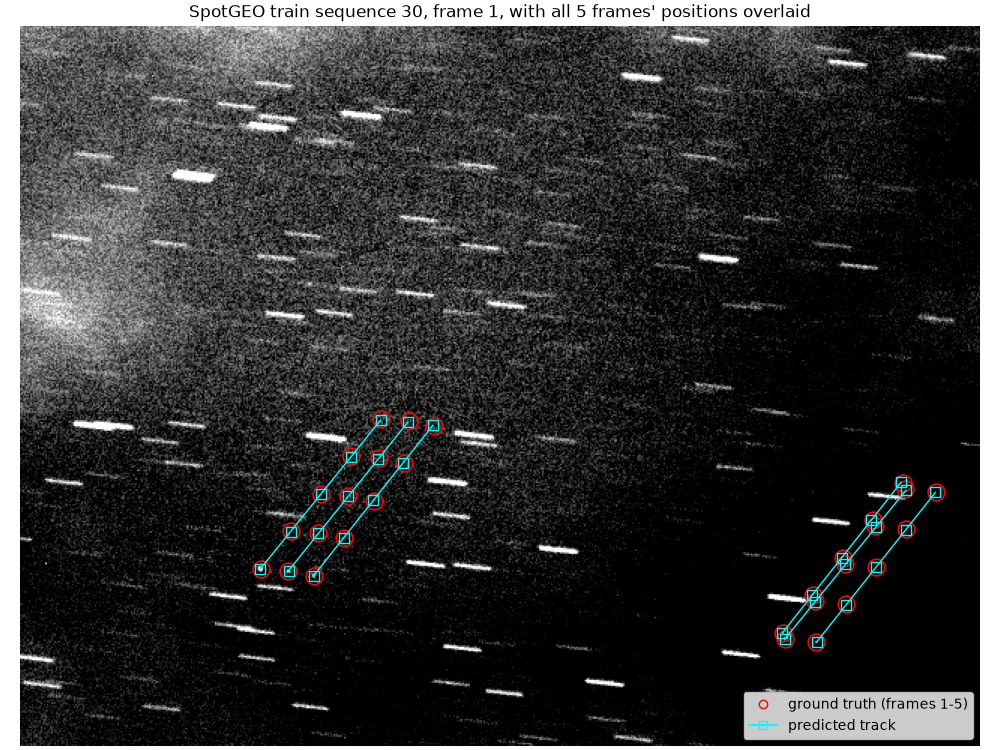
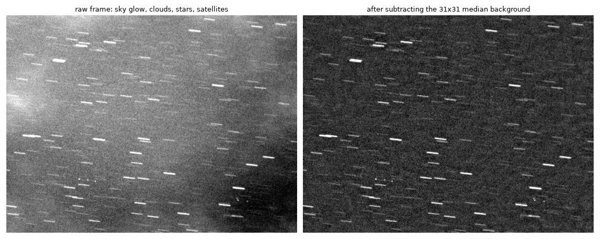
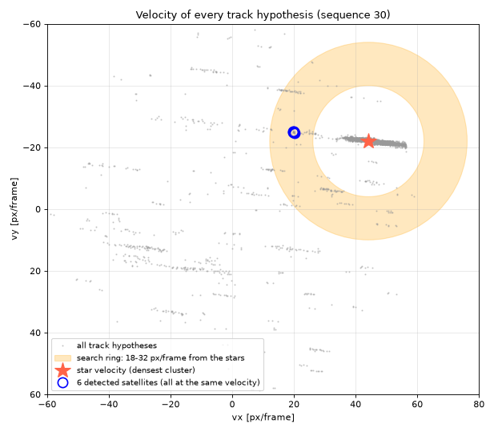
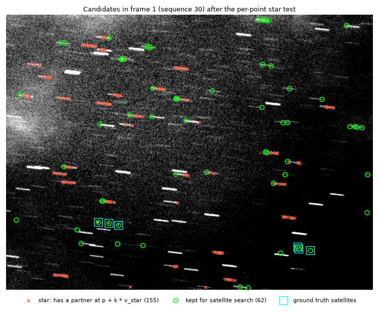
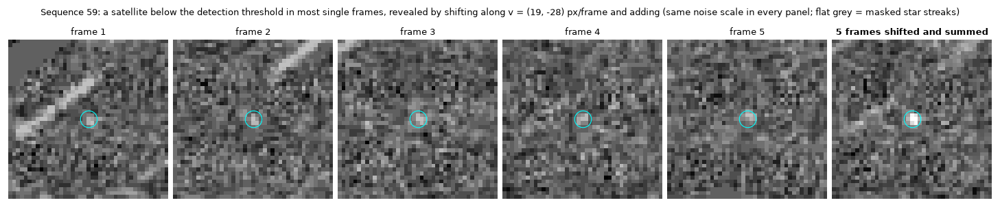

# Spotting GEO satellites without deep learning

A classical, fully explainable pipeline for the ESA Kelvins **SpotGEO** challenge: find faint geostationary satellites in 5-frame sequences of ground-based telescope images, where stars streak across the frame and the satellites are often barely above the noise.

On the official test set (5,120 sequences, scored once with the official toolkit) it reaches **F1 = 0.879**, on par with **6th place of 14** on the 2020 final leaderboard (a post-hoc comparison, see below). The winning entry used an ensemble of 10 U-Net CNNs. This one uses medians, connected components, voting and a little physics, and runs in about 0.4 s per sequence on a laptop CPU.



*Train sequence 30: all six satellites found. Red circles are the labels in frames 1 to 5. Cyan squares and lines are the predicted constant-velocity tracks. The short white dashes are stars.*

## Results

| Split | Sequences | TP | FN | FP | Precision | Recall | **F1** | MSE |
|---|---|---|---|---|---|---|---|---|
| Train 1 to 100 (used for tuning) | 100 | 885 | 120 | 30 | 96.7% | 88.1% | 0.922 | 1,118 |
| Train 101 to 300 (held out) | 200 | 1,360 | 335 | 50 | 96.5% | 80.2% | 0.876 | 2,972 |
| **Official test set (run once)** | **5,120** | **36,580** | **7,970** | **2,085** | **94.6%** | **82.1%** | **0.879** | **71,192** |

Comparison with the [final leaderboard](https://kelvins.esa.int/spot-the-geo-satellites/final-ranking). Teams are ranked by 1 − F1, and MSE is only a tie-breaker:

| Rank | Team | 1 − F1 | MSE |
|---|---|---|---|
| 1 | AgeniumSPACE | 0.0517 | 33,839 |
| 2 | POTLAB@BUAA | 0.0557 | 30,542 |
| 3 | dwiuzila | 0.0711 | 41,198 |
| 4 | Magpies | 0.0957 | 48,920 |
| 5 | Mr_huangLTZaaa | 0.1158 | 62,022 |
| **–** | **this repo** | **0.1208** | **71,192** |
| 6 | francescodg | 0.1211 | 65,772 |
| 7 | mhalford | 0.1230 | 69,567 |

Reading this table fairly:

- **The comparison is post hoc.** This work was done years after the challenge, with the challenge paper available and with the test labels published (they were used once, for the final score only).
- **The F1 is effectively tied with 6th place.** The margin is 0.0003.
- **The MSE is worse than every team ranked 1 to 7.** Missed and false detections each cost a fixed penalty, and this pipeline misses more satellites.
- **Leaderboard size:** 14 teams were ranked. The leaderboard page also lists unranked entries that did not submit a method description.

How the evaluation was kept honest:

- Every design choice and threshold was tuned on train sequences 1 to 100 only.
- Sequences 101 to 300 were held out to estimate generalization. The held-out F1 (0.876) predicted the test F1 (0.879) closely.
- The test set was run exactly once, after the method was frozen, and scored with the organizers' own `validation.py`.
- The local metric (`src/metric.py`) reproduces the official scorer exactly. On the held-out predictions both give F1 0.876 and MSE 2972.41.

## How it works

Each sequence is 5 grayscale frames of 640 × 480. Between frames both the stars and the satellites move across the image, typically by tens of pixels. All the stars move together, and each one leaves a short streak during the exposure. The satellites are point-like and move differently from the stars, because they rotate with the Earth while the stars don't. Most of the pipeline is about getting rid of stars and noise without throwing away faint satellites.

### 1. Background removal and candidate detection (`detect.py`, `detect_fast.py`)

- **Background:** subtract a 31 × 31 median filter, which removes sky gradients and clouds but keeps small sources.
- **Noise level:** estimated with iterative sigma clipping, so stars don't inflate it.
- **Candidates:** pixels above 4σ are grouped into connected components, and each component's intensity-weighted centroid becomes a candidate.
- **Rejected components:** anything whose bounding box is longer than 6 px in either direction (a star streak), and anything touching the image border.



*Train sequence 1, frame 1. Each raw frame is split into a smooth background and a residual. The background (middle) is the sky glow, a brightness gradient across the field, estimated by a 31 × 31 median filter, which ignores anything as small as a star or a satellite. The residual (right) keeps only compact sources on flat noise, and that is where detection runs.*

### 2. Two physical priors, measured from the labels

Two facts about the training labels drive most of the later decisions:

1. **All satellites in a sequence move with almost the same velocity.** The median spread is 0.2 px/frame, because they all sit on the geostationary belt.
2. **Their velocity relative to the stars is almost constant, about 26.7 px/frame** (5th to 95th percentile: 21.8 to 27.1). This is the Earth's rotation, expressed in this camera's pixels per frame interval, so the number is specific to this dataset. The absolute satellite speed varies much more between sequences, because the stars' apparent motion does.

<p align="center"></p>

*Every pair of candidates gives a velocity hypothesis (grey). The stars form one dense cluster (red star). The six detected satellites, all of them correct in this sequence, share a single velocity (blue circle) inside the ring 18 to 32 px/frame away from the stars (orange), which is where the search is restricted.*

### 3. Star velocity and per-point star removal (`pipeline.py`)

- **Track hypotheses:** every pair of candidates in two different frames defines a constant-velocity hypothesis, up to 60 px/frame, which is kept if at least 3 frames have a candidate within 1.5 px of its prediction. This is a hypothesize-and-verify scheme in the RANSAC and Hough family.
- **Star velocity:** the most common hypothesis velocity, refined with the median of nearby frame-to-frame displacements.
- **Star test:** a candidate is labelled a star if any other frame has a candidate at the position the star velocity predicts (within 2.5 px). Testing each point individually removes far fewer satellite points than deleting every member of a star-like track.



*Red crosses are candidates identified as stars and removed. Green circles are candidates kept for the satellite search. Cyan squares are the labelled satellites, and all of them survive. Some kept candidates sit at the ends of star streaks, where a streak breaks into fragments that the star test can't pair. The speed ring and the confirmation step deal with them later.*

### 4. Satellite tracks (`pipeline.py`)

- **Hypotheses:** constant-velocity hypotheses are rebuilt on the remaining points, with a 2 px tolerance.
- **Speed ring:** only hypotheses whose speed relative to the stars lies in 18 to 32 px/frame are kept (prior 2).
- **Inside the image:** a track must stay inside the frame in all 5 frames.
- **Deduplication:** when two tracks are within 5 px of each other on average, only the one with more members is kept.
- **Confirmation from the pixels:**
  - A track found in all 5 frames is accepted.
  - Otherwise, the 3 × 3 residual sum is measured at the predicted position in every frame where no candidate was found. The track is accepted only if every one of those frames shows at least 2σ of signal.
  - Effect: fewer false alarms (a chance alignment has nothing at the missing positions) and more detections (a faint satellite that dipped below the 4σ threshold still shows up).

### 5. Shift-and-add stacking for faint satellites (`pipeline.py`)

When at least one satellite is confirmed, its velocity predicts the velocity of every other satellite in the sequence (prior 1).

- **Stacking:** the 5 noise-normalized residual frames are shifted along that velocity, over a 3 × 3 grid of ±1 px/frame around it, and summed. A satellite moving at that velocity adds up 5×, while the noise only adds up √5×.
- **Star suppression:** bright star streaks are masked first, and residuals are clipped at ±3σ so that a single bright pixel can't dominate.
- **Accepting a peak:** it needs about 11σ of stacked signal, signal in at least 4 of the 5 frames, and no single frame contributing more than 60% of it.



*Train sequence 59. Each panel is a 41 × 41 px window centred on the predicted position, on the same noise scale. In four of the five frames this satellite peaks below the 4σ detection threshold, so it is never detected as a track. Once the five frames are aligned along its velocity and summed, it stands out clearly.*

### Progression on the tuning set

| Step | TP | FN | FP | F1 |
|---|---|---|---|---|
| Baseline: 5σ detection, vote, delete star-track members | 684 | 321 | 66 | 0.779 |
| + relative-speed ring 18 to 32 px/frame | 675 | 330 | 20 | 0.794 |
| + detection threshold 4σ | 745 | 260 | 60 | 0.823 |
| + a 3-frame track needs a 4-frame partner at the same velocity | 745 | 260 | 45 | 0.830 |
| + per-point star test with refined star velocity | 805 | 200 | 50 | 0.866 |
| + confirmation from pixel signal (replaces the partner rule) | 860 | 145 | 30 | 0.908 |
| + shift-and-add stacking | **885** | **120** | **30** | **0.922** |

The intermediate versions are not kept in the repository. The table records the scores measured at each step during development, and only the final row is reproducible from `src/`.

### Speed

The first working version took about 21 s per sequence, which meant about 30 hours for the test set. Three changes made it about 50× faster without changing any result. After each one, the full run on the tuning set gave exactly the same TP, FN, FP and MSE. The two changes that replace a computation also have comparison scripts that assert exact equality with the original code:

- `test_median.py` checks the residual image and noise on 3 frames.
- `test_tracks.py` checks every hypothesis's start point and velocity on 5 sequences.

| Change | Time per sequence |
|---|---|
| Compute the background once instead of twice | 21 s → 11.5 s |
| OpenCV's histogram median (`cv2.medianBlur`) with symmetric padding (identical to scipy's `reflect` mode) instead of `scipy.ndimage.median_filter` | 11.5 s → 2.8 s |
| Vectorized hypothesis building with `scipy.spatial.cKDTree` | 2.8 s → **0.4 s** |

With 8 worker processes, the whole test set runs in about 5 minutes. Timings are from a laptop with a 20-thread CPU.

**Reproducibility:** on the author's machine (Windows 11, Python 3.13), a fresh clone installed from `requirements.txt` reproduces the tuning-set numbers above. It also produces a byte-identical test submission, with SHA-256 `9d7ca4bd…ff96d881`. Other platforms may differ in the last floating-point digits.

## Design notes

**Why not a Kalman filter?** With only 5 frames and a constant-velocity model, a Kalman filter reduces to a least-squares line fit. Fitting is not the hard part. The hard part is data association: deciding which of about 190 candidates per frame belong together. Exhaustive pairwise hypotheses plus voting solve that directly.

**Some "false alarms" are probably real satellites.** Several false-positive tracks in the training set move at exactly the shared velocity of the labelled satellites in the same sequence (for example train sequences 1 and 84). Random noise has no reason to pick that velocity. These are most likely faint satellites that the human labellers missed, so the measured precision may be somewhat underestimated.

**Known failure modes:**

- **Sequences with no confirmed satellite get no stacking.** Running the stack over the whole speed ring instead flooded the results with noise peaks.
- **Satellites that move unusually fast relative to the stars are dropped by the speed ring.** One example is train sequence 4, at about 38 px/frame.
- **Satellites that overlap a star streak can be erased by the streak mask.**
- **The pixel confirmation measures the unmasked residual.** If a missing-frame prediction lands on a star streak, the streak's light passes the 2σ test. Stacking uses streak-masked frames, but confirmation does not, which is a likely source of false positives.
- **Three test sequences (1040, 2353, 4047) flooded with false detections.** Each hit the challenge's limit of 30 predictions per frame (enforced in `run_test.py`) against 2 to 3 real objects. Together they account for 435 of the 2,085 test false positives.

These are left unfixed on purpose: changing the method after seeing test results would be tuning on the test set.

**About the official MSE:** the official `validation.py` differs from the challenge paper. It adds up unsquared distances, and it sums the per-sequence MSEs instead of averaging them. `src/metric.py` follows the code, since that is what produced the leaderboard.

## Running it

Tested with Python 3.13.

```bash
python -m venv .venv
source .venv/bin/activate       # Windows PowerShell: .venv\Scripts\Activate.ps1
pip install -r requirements.txt
```

Download `SpotGEOv2.zip` from the [SpotGEO dataset](https://doi.org/10.5281/zenodo.4432143) and unzip it into `data/`, so the layout is `data/SpotGEOv2/{train,test}/<sequence>/<frame>.png`, with `train_anno.json` and `test_anno.json` next to the folders. Then run from `src/`:

```bash
cd src
python run_many.py          # score train sequences 1 to 100, sequence by sequence
python run_test.py          # predict all 5,120 test sequences -> ../submission.json
python score_official.py    # validate and score with the official kit (see below)
```

`score_official.py` expects the organizers' `validation.py` from the [starter kit](https://zenodo.org/records/3874368) in an `official_kit/` folder at the repo root. It is not redistributed here.

## Repository layout

```
src/
  detect.py          original background (scipy median) and find_blobs (candidates), shared by both versions
  detect_fast.py     same background with the OpenCV median (used by the pipeline)
  pipeline.py        star velocity, star test, tracks, confirmation, stacking
                     (build_tracks is the readable reference, build_tracks_fast the one used)
  metric.py          official F1 and MSE, per frame and per sequence
  run_many.py        evaluate on training sequences
  run_test.py        parallel prediction on the test set, writes the submission file
  score_official.py  run the official validator and scorer
  test_median.py     asserts: fast median == original median
  test_tracks.py     asserts: fast hypothesis builder == reference
explore/             early exploration scripts and the README figures
                     (make_example_figure.py, make_figures.py)
docs/                figures
```

## Acknowledgements

- **Dataset:** B. Chen, D. Liu, T.-J. Chin, M. Rutten, D. Derksen, M. Märtens, M. von Looz, G. Lecuyer, D. Izzo. *SpotGEO dataset*, Zenodo, 2021, [doi:10.5281/zenodo.4432143](https://doi.org/10.5281/zenodo.4432143), CC BY 4.0.
- **Challenge and metric:** B. Chen et al., *Spot the GEO Satellites: From Dataset to Kelvins SpotGEO Challenge*, CVPR Workshops 2021.

## License

MIT, see [LICENSE](LICENSE). The dataset is distributed separately under CC BY 4.0.
